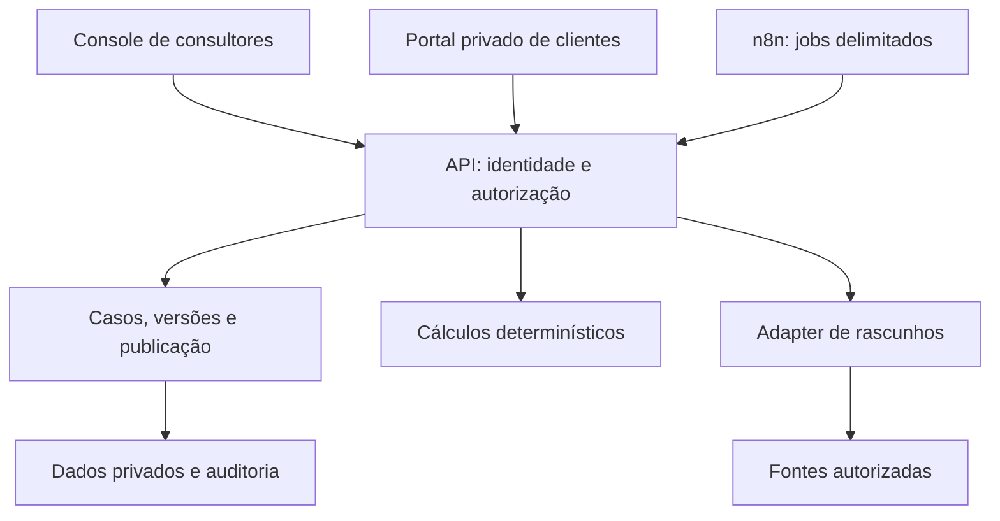

# Arquitetura e limites

## Objetivo aprovado

Consultores da Capital Web3 produzem diagnósticos com evidências. Um revisor
humano aprova uma versão específica. A entrega ao cliente exige publicação
explícita dessa versão para destinatários autorizados. O cliente recebe,
confirma a entrega ou pede esclarecimento e decide como proceder.

## Fronteiras de confiança

Na demonstração, API e lógica executam em Python; interface usa HTML/CSS/JS,
dados são fictícios e em memória. Não há chamadas externas nem credenciais.
Em staging, Sites poderá hospedar a interface e seu runtime de borda; um
backend Python separado deverá portar identidade, autorização e cálculos.
Supabase é a proposta para Auth/Postgres/Storage. n8n coordena jobs e eventos;
MCP expõe capacidades autorizadas, sem substituir a API de domínio.

## Invariantes

- O navegador, o modelo e o documento importado não definem identidade/tenant.
- Cada objeto exige atribuição do consultor ou membership ativo do cliente.
- Cliente vê somente a versão publicada que o inclui nos destinatários.
- Aprovação humana e publicação são estados mantidos pelo servidor, fora do
  texto gerado pelo modelo; nova versão exige nova revisão.
- Revogação bloqueia futuras leituras e downloads. Não recupera um arquivo já
  baixado; URLs assinadas reais deverão ter TTL curto e controles adicionais.
- Auditoria não inclui o conteúdo sensível do relatório ou segredos.
- Datas das fontes e qualidade dos dados acompanham cálculos e relatório.
- Receipt/underlying repetidos não podem duplicar NAV; dívida é descontada.
- IL 50/50 não é aplicado a liquidez concentrada; os benchmarks são explícitos.
- Trades, custody, approvals e assinatura ficam fora do produto inicial.

## Entidades do plano

| Grupo | Entidades |
|---|---|
| Identidade | staff_user, staff_role, client_identity, client_membership |
| Atendimento | client_case, consent, wallet_reference |
| Dados | data_source, portfolio_snapshot, position, liability |
| Análise | risk_finding, scenario, report |
| Entrega | human_review, report_publication, read_receipt, clarification_request |
| Operação | audit_event, job |

O protótipo implementa apenas o ciclo de casos, relatórios e entrega e os
cálculos essenciais. Consentimento persistente, dados financeiros coletados,
fontes reais seguem no backlog. Budget e jobs SQLite duráveis foram adicionados
para ensaios locais; não estão conectados à OpenAI nem a uma instância n8n.
Uma lista de entidades não
equivale à implementação completa de todas elas.

## Decisões iniciais

- **Python stdlib e Decimal:** teste reproduzível sem instalar bibliotecas ou
  ligar provedores. `http.server` é exclusivamente local; migrar a camada HTTP
  para serviço de produção com limites e autenticação reais antes de staging.
- **Sem custódia e sem execução financeira:** integrações de DEX, wallets e RPC
  deverão usar consultas/simulações de leitura com consentimento e allowlists.
- **Sem orquestrador de agentes adicional:** código resolve cálculos/permissões;
  OpenAI elaborará a linguagem de um rascunho após validação/budget persistente.
- **MCP stdio primeiro:** útil para ensaiar contratos. MCP remoto exige OAuth,
  audience, scopes, transporte e interoperabilidade comprovados.
- **Supabase descartável separado:** a CI gera migrações com a CLI e executa
  SQL, Auth, PostgREST e Storage com fixtures sintéticas. A API Edge reutiliza
  o JWT verificado sob RLS. Deploy da Edge e Auth de produção são gates próprios.

## Material de referência

Requisitos derivados do plano anexado v1.2 e das instruções autorizadas do
advisor. O arquivo original, organograma e documentos privados não foram
copiados para este repositório público. Fontes técnicas públicas verificadas
ficam em `docs/integrations.md` e `docs/supabase.md`.
