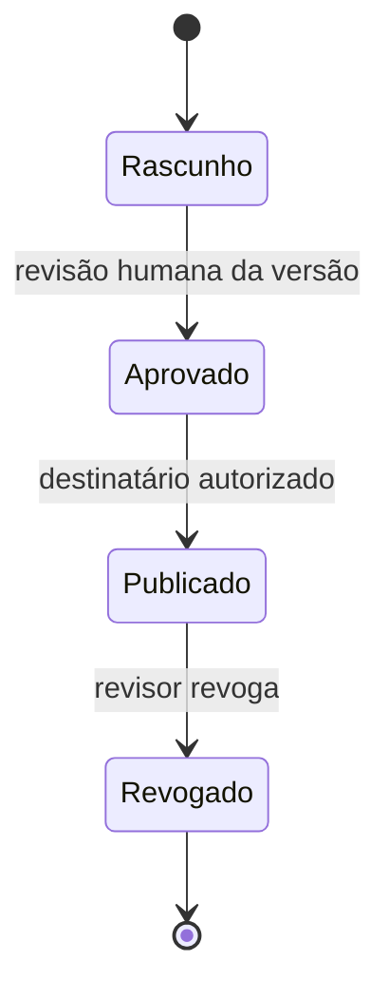

# Console e portal local

`make demo` inicia `http://127.0.0.1:8765`; somente loopback é permitido.
O seletor de personas serve para testes, não autentica pessoas reais.
Sessões aleatórias no servidor, cookies HttpOnly/SameSite, token CSRF independente,
checagens de Host/Origin e limites de corpo protegem esta demonstração local.
TLS, login real, controles distribuídos e persistência são gates de staging.

| Persona | Caso | Permissão |
|---|---|---|
| Ana | A | Preparar rascunho e inspecionar o caso atribuído |
| Rui | A | Revisar, publicar e revogar versão específica |
| Cliente A | A | Ler somente publicação autorizada; receipt e esclarecimento |
| Cliente B | B | Ler publicação fictícia B; não acessa caso A |

Cada solicitação resolve a identidade pela sessão do servidor. Headers de role,
tenant ou usuário são ignorados. Recursos inexistentes e inacessíveis têm a
mesma resposta genérica, sem revelar a existência do diagnóstico.

Novo rascunho cria nova versão sem herdar aprovação. Uma publicação já existente
continua acessível enquanto não for revogada; um novo rascunho privado não é
revelado ao cliente. A publicação atual não permite alterar seus destinatários:
nova entrega exige nova versão/revisão. Receipt é idempotente por pessoa/versão.

## API de demonstração

| Método e rota | Uso |
|---|---|
| POST `/api/demo/session` | Persona fixa; exige X-Demo-Intent local-testing |
| GET `/api/session` | Sessão atual e CSRF para esta persona fictícia |
| POST `/api/logout` | Invalida a sessão |
| GET `/api/cases`, `/api/reports` | Projeção autorizada |
| GET `/api/reports/{id}` | Conteúdo autorizado da versão |
| POST `/api/cases/{id}/draft` | Rascunho fictício somente para staff atribuído |
| POST `/api/reports/{id}/approve` | Revisão pelo revisor de caso |
| POST `/api/reports/{id}/publish` | Versão aprovada + recipients permitidos |
| POST `/api/reports/{id}/revoke` | Revogação de publicação |
| GET `/api/reports/{id}/download` | Download JSON com ACL reavaliada |
| POST `/api/reports/{id}/receipt` | Confirmação de recebimento |
| POST `/api/reports/{id}/clarify` | Dúvida sobre diagnóstico autorizado |
| GET `/api/risk` | Cenários sintéticos para staff local |

Mutação exige JSON e token CSRF desta sessão. Conteúdo de rascunho não é recebido
do navegador nessa rota: vem do adapter fixo. `status` interno descreve qualidade
da análise; `state` externo descreve revisão/publicação e é mantido pelo servidor.

## Testes da interface

Teste HTTP exercita o fluxo real local. O harness Node executa o JS da aplicação
com uma superfície DOM mínima e verifica logout/descartes de respostas antigas;
não comprova layout, acessibilidade ou compatibilidade de navegador.
Dados e DOM são limpos na troca de sessão. Conteúdo externo é inserido por
textContent, sem HTML arbitrário.
